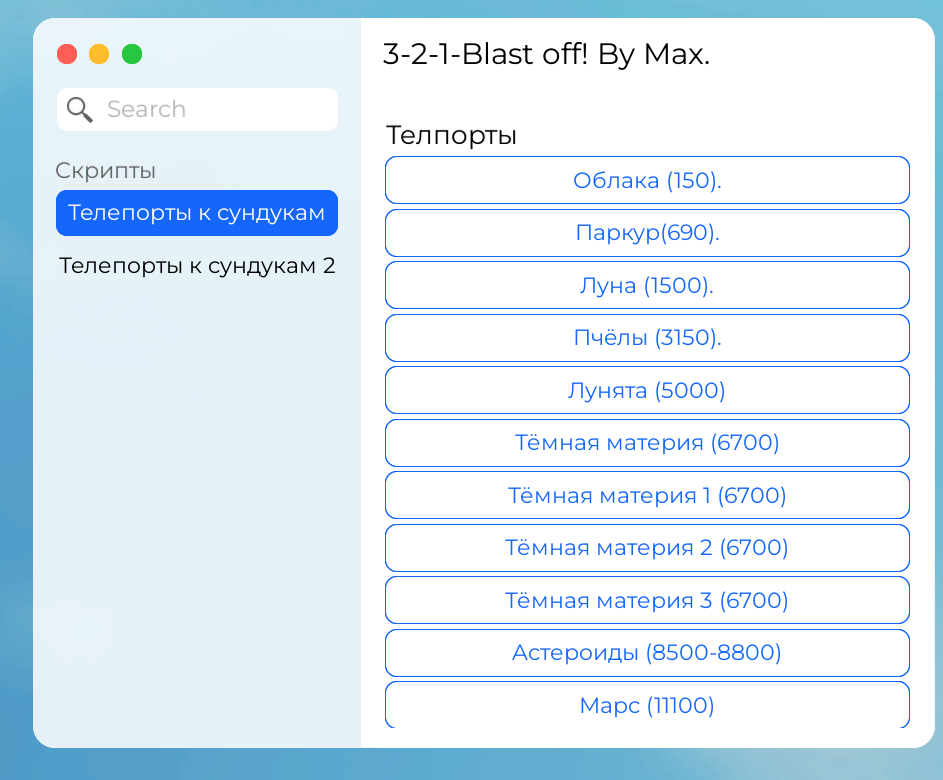

# 🚀 Roblox Script for [3-2-1 Blast Off Simulator!](https://www.roblox.com/games/5256165620)

🌐 **English** | [Русский](README.ru.md)

**Author:** [maks3592](https://github.com/maks3592)  
**License:** [MIT License](https://en.wikipedia.org/wiki/MIT_License)  
**Website:** [maks3592.github.io/Roblox-script](https://maks3592.github.io/Roblox-script/) — the script can also be downloaded from there 📥 (the site has an EN/RU language switch)  

## 📌 Description  
This script enhances gameplay in **Roblox** by allowing instant teleportation to chests, making loot collection faster and more efficient.  

## 🔥 Features  
✅ **Instant teleportation** to all chest locations  
✅ **Optimized UI** for easy interaction  
✅ **Smooth execution** for stable gameplay  
✅ **Compatible** with popular executors  
🛑 **Note:** Some chests require quests to unlock access.  

## 📥 How to Download & Install  

### 🔹 Method 1: Download from the website  
Open the [**website**](https://maks3592.github.io/Roblox-script/) and press **Download script.lua** (you can also copy a ready-made loader there).  

### 🔹 Method 2: Download from GitHub  
1️⃣ Go to the [**Releases**](https://github.com/maks3592/Roblox-script/releases) section of this repository.  
2️⃣ Find the latest version (`v2.0` or newer).  
3️⃣ **Download `script.lua`** directly from the release page.  
4️⃣ Open **Roblox executor**, load the script, and execute it.  

### 🔹 Method 3: 📝 How to Use RAW Script  

1️⃣ **Open the RAW script link:**  
   👉 [RAW version of script](https://raw.githubusercontent.com/maks3592/Roblox-script/refs/heads/main/shortscript.lua)  
2️⃣ **Copy the entire code** (`CTRL + C`).  
3️⃣ **Open Roblox executor**.  
4️⃣ **Paste the code** (`CTRL + V`).  
5️⃣ **Inject** the executor and **run the script**.  
6️⃣ Enjoy instant chest teleportation! 🚀  
